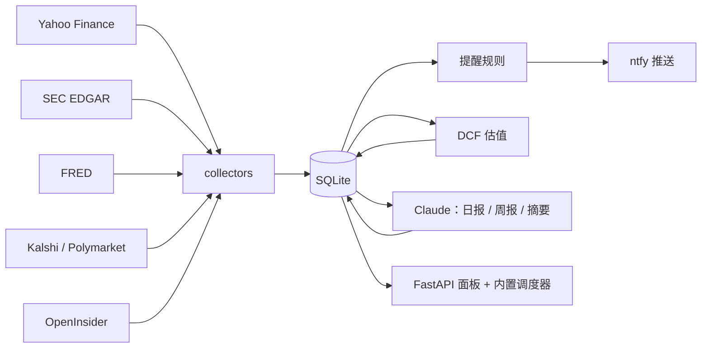

# AI Stock Radar · 投资雷达

**自托管的 AI 股票 / 宏观监控面板。** 盯住你的持仓和潜在标的、SEC 公告和内部人交易、宏观数据和预测市场；异动时推送到手机；用 Claude 写开盘前日报、财报摘要、8-K 摘要和周报。

*Self-hosted AI stock & macro monitoring dashboard — holdings alerts, SEC filings & insider trades, DCF valuation, earnings calendar, prediction markets (Kalshi / Polymarket), and Claude-written daily & weekly reports. [English summary below](#english).*

> ⚠️ 个人项目，仅供学习研究，**不构成任何投资建议**。数据来自公开免费来源，可能延迟或出错。按现状提供（MIT），不承诺维护。

---

## 它能做什么

| 页面 | 内容 |
|---|---|
| **总览** | 持仓 / 关注列表：价格、日涨跌、周涨跌、距 52 周高点、迷你走势；最近的提醒；网页上直接增删标的 |
| **日报** | 每个交易日开盘前（美东 9:25）自动拉盘前数据：股指期货、VIX、10 年期利率、美元、原油、黄金、BTC、每只持仓的盘前价，加上隔夜 8-K 和当天财报 → Claude 写成 1–2 分钟能读完的日报 |
| **宏观** | FRED 宏观序列（CPI、失业率、利差等）；Kalshi / Polymarket 预测市场，含市场隐含的 Fed 利率路径和会后对比 |
| **发现** | 每周三个渠道找候选：① 量化筛选 ② 主题股票池里“好公司打折” ③ 聪明钱（OpenInsider 集体买入、著名基金 13F 新建仓/加仓）；每只附 DCF 估值、中文公司简介和 Claude 的“值得看 / 风险”点评；筛选条件网页可改 |
| **估值** | DCF：SEC 财报 + 分析师收入预期，增长率线性收敛到永续；网页上改假设实时重算，带敏感性表和历史财务 |
| **财报** | 即将发布的财报日历（近 4 季超预期次数）、近期财报的股价反应；Claude 汇总每次财报并标记重要度；网页增删标的 |
| **逻辑** | 每只股票的买入逻辑、关键指标、逻辑破坏条件，网页编辑；日报 / 周报 / 助手都会参考 |
| **周报** | 每周日 Claude 汇总：持仓异动、8-K、内部人交易、宏观与预测市场变化、候选池 |
| **个股页** | 价格走势、8-K（含 Claude 一句话摘要）、内部人买卖、历次财报 |
| **助手** | 页面右侧的聊天，自动带上你正在看的页面数据，可联网搜索 |

**手机推送（[ntfy](https://ntfy.sh)）**：持仓单日大涨大跌、穿越价位线、8-K 重大事项（并购、破产、高管变动、财报重述…）、内部人大额买入 / 集体买入、财报发布、预测市场概率 24h 内大幅变化、VIX > 30、收益率曲线倒挂、任务失败。规则都在 `config/rules.yaml`，带静默时段和去重。

## 架构



- **纯 Python**：FastAPI + Jinja 服务端渲染（手机友好），SQLite 单文件，没有前端构建。
- **确定性的部分不用 LLM**：价格、阈值、提醒全部是规则；Claude 只负责“读完写总结”。
- **Claude 是可选的**：不配置也能用，相关页面显示原始数据。

## 快速开始（本机，5 分钟）

需要 Python 3.12+。

```bash
git clone https://github.com/lyuyues/ai-stock-radar.git && cd ai-stock-radar
python3 -m venv .venv && .venv/bin/pip install -e '.[dev]'
cp .env.example .env
# 1) .env 里填 SEC_USER_AGENT，例如 "my-radar you@example.com"（SEC 要求带联系方式）
# 2) 编辑 config/watchlist.yaml，放你的持仓和关注（之后也可以在网页上改）
.venv/bin/python -m radar daily    # 第一次拉数据：价格+1年历史、SEC、宏观、财报、预测市场
.venv/bin/python -m radar serve    # 打开 http://127.0.0.1:8770
```

跑测试：`.venv/bin/python -m pytest -q`（不联网）

## 配置

| 文件 | 作用 |
|---|---|
| `.env` | `SEC_USER_AGENT`（必填）、`NTFY_TOPIC` / `NTFY_SERVER`（推送）、`RADAR_PUBLIC_URL`（推送里的链接）、`CLAUDE_CMD`（Claude 功能） |
| `config/watchlist.yaml` | 持仓、关注、价位线（网页上增删的标的存在数据库里，优先级更高） |
| `config/rules.yaml` | 提醒规则、静默时段、心跳 |
| `config/macro.yaml` | FRED 序列、预测市场 |
| `config/discovery.yaml` | 发现页的筛选条件、主题股票池、13F 基金（网页「发现 → 筛选设置」也能改） |

### Claude 功能（可选）

日报、财报摘要、8-K 摘要、候选点评、公司简介、周报和右侧助手通过 [Claude Code](https://claude.com/claude-code) 命令行（`claude -p`）调用。装好并登录后，在 `.env` 里加：

```
CLAUDE_CMD=claude -p --output-format text --allowedTools WebSearch,WebFetch
```

请按你自己账号的使用条款使用；要给多人用，请改用按量计费的 API 并设好额度，不要共享个人订阅。

### 手机推送

手机装 ntfy App，订阅一个**只有你知道的随机 topic 名**，写进 `.env` 的 `NTFY_TOPIC`，然后 `python -m radar test-push` 测试。

## 定时任务

| 任务 | 命令 | 默认时间（`deploy/systemd/*.timer`，太平洋时间） |
|---|---|---|
| 价格 + 价格提醒 | `prices` | 美股交易时段每 30 分钟 |
| SEC 8-K / Form 4 + 摘要 | `edgar` | 每天收盘后 |
| 财报 + 财报摘要 | `earnings` | 每天收盘后 |
| FRED 宏观 | `macro` | 每天 |
| 预测市场 | `markets` | 每小时 |
| 发现候选 | `discover` | 每周日 |
| 周报 | `weekly` | 每周日（发现之后） |
| 健康检查 | `heartbeat` | 每小时 |
| 开盘前日报 | `brief` | 网页服务内置调度：交易日美东 9:25 |
| 估值刷新 | `valuation` | 内置调度：每周六 |

本机可以用 cron / launchd 调 `python -m radar <任务>`；`python -m radar daily` 一次跑完每日任务。服务器用下面的 systemd。

## 部署到服务器

`deploy/install.sh`（Ubuntu / Debian）会：建系统用户 `invest`、把代码放到 `/opt/invest-radar`、建 venv、装 systemd 定时器和网页服务、跑第一次数据加载。

```bash
git clone https://github.com/lyuyues/ai-stock-radar.git ~/invest-radar
cd ~/invest-radar && cp .env.example .env && nano .env
bash deploy/install.sh
```

> 🔒 **面板本身没有登录功能。** 不要直接暴露到公网。推荐 Cloudflare Tunnel + Cloudflare Access（只允许你的邮箱），或者 Tailscale / VPN / 带认证的反向代理。

## 目录结构

```
radar/              采集、提醒、估值、Claude 生成（CLI 入口：python -m radar）
  collectors/       prices（Yahoo）/ edgar（SEC）/ macro（FRED、Kalshi、Polymarket、财报）
  alerts/           规则 → 触发 → 去重 / 静默
  dcf/              DCF 引擎
  prompts/          日报 / 周报 / 财报摘要提示词（改这里就能改报告风格）
web/                FastAPI 路由、Jinja 模板、内置调度器
config/             watchlist / rules / macro / discovery
deploy/             systemd 单元、安装脚本
tests/              pytest（不联网）
```

## FAQ

- **要花钱吗？** 数据源都免费；Claude 功能用你自己的 Claude 账号。
- **支持港股 / 其他市场吗？** 价格和估值走 Yahoo，代码格式正确（如 `0700.HK`）一般能用；SEC、13F、内部人交易只覆盖美股。
- **报告能改成英文吗？** 改 `radar/prompts/*.md` 里的语言要求即可；网页界面目前是中文。

---

<a id="english"></a>
## English summary

AI Stock Radar is a self-hosted, single-user dashboard for long-term investors:

- **Watch** holdings and a watchlist (prices, moves, distance from the 52-week high) with rule-based push alerts via ntfy.
- **Filings & insiders**: SEC 8-K items and Form 4 open-market buys / cluster buys; each 8-K summarized by Claude.
- **Macro**: FRED series and Kalshi / Polymarket odds, including the market-implied Fed path.
- **Discover** candidates weekly from a quant screen, themed baskets trading below their highs, insider cluster buys and 13F adds — each with a DCF value and a short Claude review.
- **Valuation**: an editable DCF (SEC financials + analyst revenue estimates) with sensitivity tables.
- **Earnings**: calendar, price reaction, and a Claude summary with an importance tag.
- **Reports**: a pre-market daily brief and a weekly report written by Claude, plus a page-aware chat assistant.

Stack: Python 3.12, FastAPI + Jinja, SQLite, systemd timers. Claude features shell out to the Claude Code CLI (`claude -p`) and are optional. The UI and reports are in Chinese; prompts live in `radar/prompts/` if you want another language. Quick start and deployment commands are above.

**Not investment advice.** MIT licensed.
